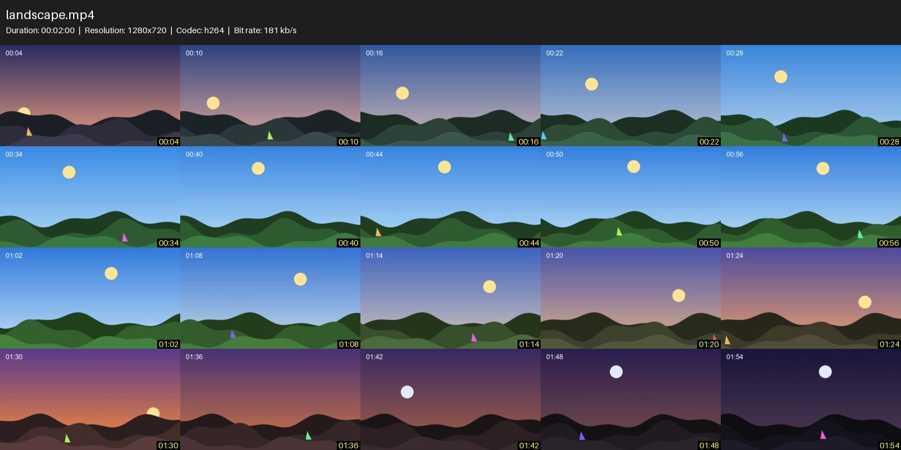
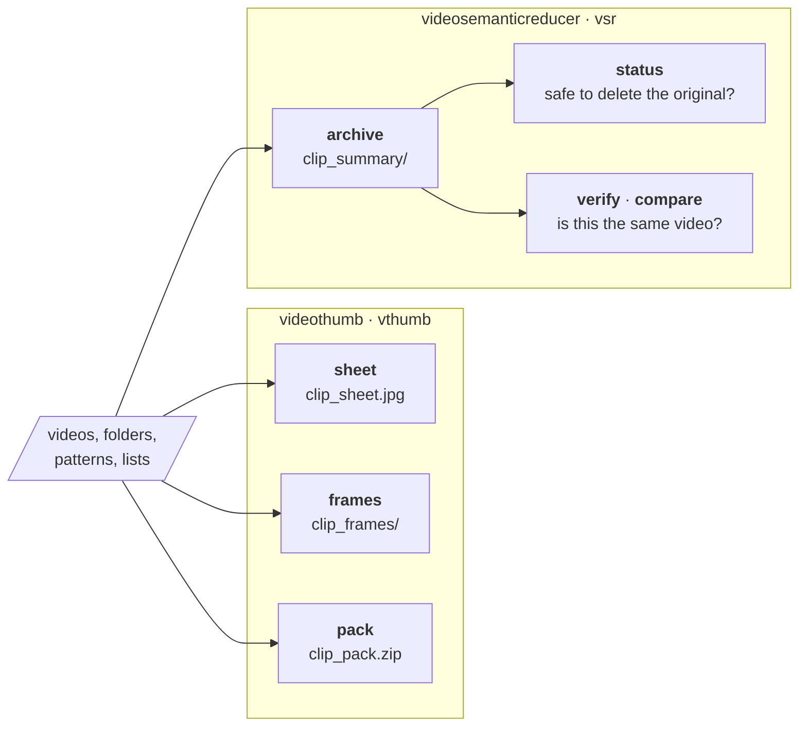
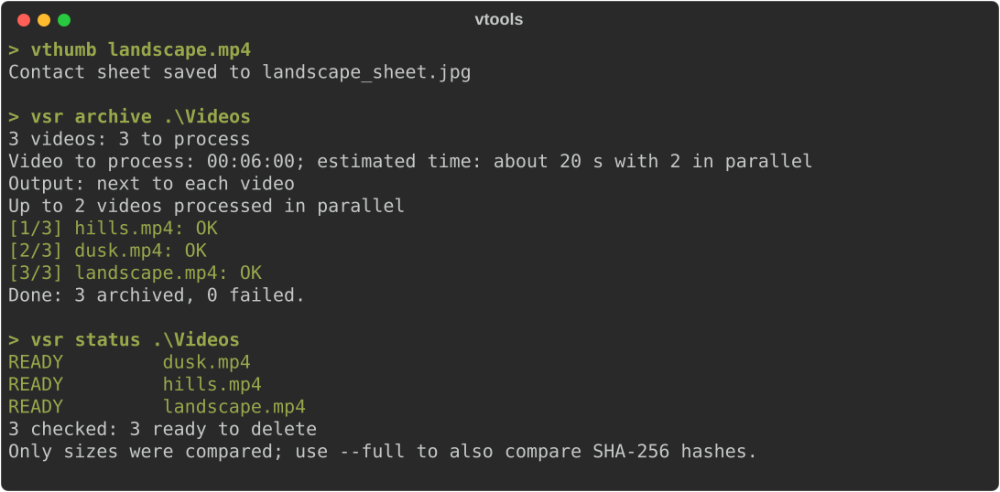
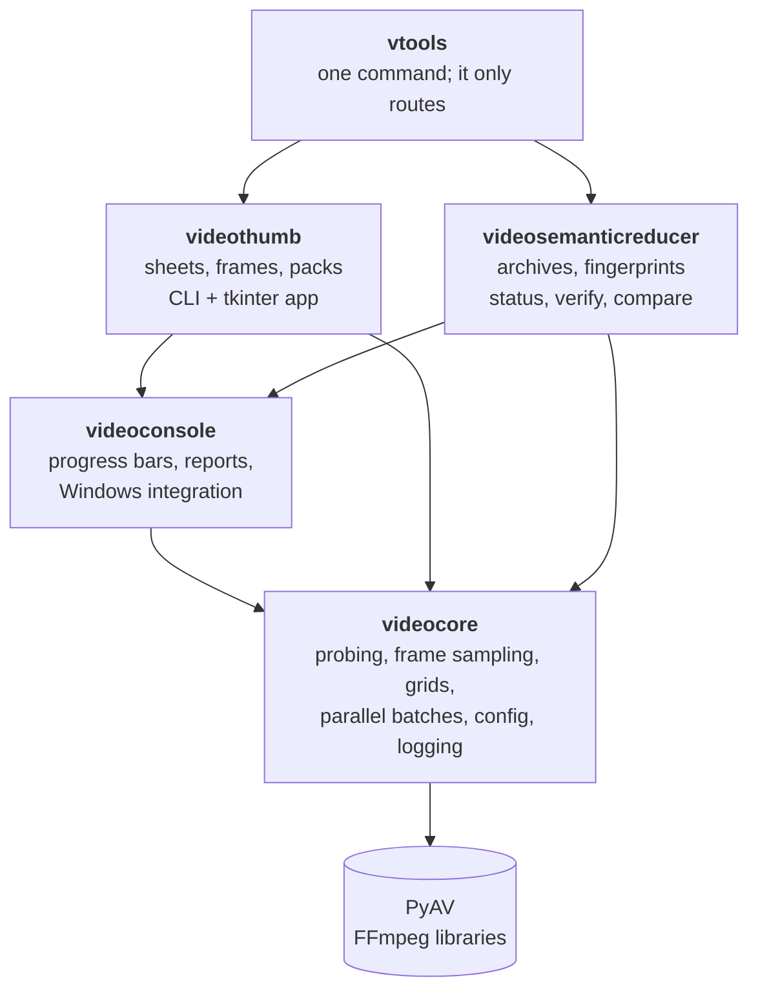

<div align="center">

# video-tools

**See what is inside your videos at a glance, and archive them before you delete them.**

Contact sheets, frames and compact video archives for any number of videos and folders,<br>
from the command line or a desktop app. No FFmpeg install needed.

[](https://github.com/dbarretol/video-tools/actions/workflows/ci.yml)




<sub>A contact sheet made by <code>vthumb landscape.mp4</code> from a synthetic two-minute video.</sub>

</div>

## Contents

- [What it does](#what-it-does)
- [Installation](#installation)
- [Quick start](#quick-start)
- [Getting help](#getting-help)
- [Choosing the videos](#choosing-the-videos)
- [In the terminal and in the Explorer](#in-the-terminal-and-in-the-explorer)
- [Scripting: exit codes and JSON](#scripting-exit-codes-and-json)
- [Performance](#performance)
- [How it is built](#how-it-is-built)
- [Development](#development)

## What it does

| Tool | Short name | What it does |
|---|---|---|
| [**videothumb**](packages/videothumb) | `vthumb` | **Previews.** A contact sheet per video (a grid of frames under its details), a folder of full-size frames, or both in one ZIP. Command line and desktop app. |
| [**videosemanticreducer**](packages/videosemanticreducer) | `vsr` | **Archives.** Before you delete a video, it keeps a short summary video, a contact sheet, a metadata report and a perceptual fingerprint, which can later tell whether another file is the same video. |
| [**vtools**](packages/vtools) | `vtools` | **One command for both:** `vtools sheet`, `vtools archive`, ... |



An archive is a folder next to the video (or under `-o`):

```
movie_summary\
  movie_summary.mp4        an info card, then evenly spaced snapshots of the whole video
  movie_sheet.jpg          contact sheet
  movie_info.txt           metadata report
  movie.fingerprint.json   perceptual fingerprint, for `verify` and `compare`
  movie.archive.json       manifest, written last: the archive is complete only when it says so
```

## Installation

**On Windows, without Python:** download `video-tools-<version>-windows-x64.zip` from the
[latest release](https://github.com/dbarretol/video-tools/releases/latest), unzip it anywhere and
add that folder to your `PATH` (or run the programs from it). It holds `vtools.exe`, `vthumb.exe`
and `vsr.exe`, which share the `_internal` folder next to them. The programs are not signed, so
Windows SmartScreen may ask for confirmation the first time.

**From the source,** on any system: you need Python 3.12 or later and [uv](https://docs.astral.sh/uv/). FFmpeg comes inside
[PyAV](https://pyav.basswood-io.com/), so there is nothing else to install.

```bash
git clone https://github.com/dbarretol/video-tools.git
cd video-tools
uv tool install ./packages/vtools --with-executables-from videothumb,videosemanticreducer
```

That puts `vtools`, `videothumb` (`vthumb`) and `videosemanticreducer` (`vsr`) on your `PATH`;
`uv tool upgrade vtools` updates them all. A single tool can be installed alone, e.g.
`uv tool install ./packages/videothumb`.

To try them without installing, use `uv run` from the clone (the first run creates the
environment): `uv run vtools help`.

## Quick start

```bash
vtools movie.mp4                      # contact sheet: movie_sheet.jpg (`sheet` is the default)
vtools frames ./videos --count 15     # 15 full-size frames of every video in the folder
vtools pack ./videos -r               # sheet and frames in one ZIP per video, subfolders too
vtools gui                            # the videothumb desktop app

vtools archive movie.mp4              # movie_summary\ with everything needed to delete the video
vtools status ./videos                # are the archives complete and unchanged?
vtools verify download.mp4 movie_summary/movie.fingerprint.json   # the same video?
```

<p align="center">
  
</p>

Each tool has the same commands under its own name: `vthumb movie.mp4`, `vsr archive movie.mp4`.
Without a command, `vthumb` runs `sheet` and `vsr` runs `archive`; `console.default_task` in the
config file chooses another. A command name wins over a file with that name: write `.\sheet` for
the file.

## Getting help

```bash
vtools help              # every command, with examples
vtools help archive      # the options of a command; the same as `vtools archive --help`
vthumb /?                # Windows style: /?, -? and /help work too
```

Each tool's README documents every option: [videothumb](packages/videothumb/README.md),
[videosemanticreducer](packages/videosemanticreducer/README.md). The defaults of each option can
be changed in a config file: `vtools config thumb show`, `vtools config vsr set num_snapshots 100`.

## Choosing the videos

`sheet`, `frames`, `pack`, `archive`, `fingerprint` and `status` take any number of paths:

- **videos and folders**: the videos of a folder, and of its subfolders with `-r`;
- **patterns** such as `D:\Videos\*.mkv`, expanded by the tool, since the Windows shell does not.
  A path that exists is used as it is, so `clip [1080p].mp4` works;
- **lists** with `--input-list FILE` (repeatable): one path per line; empty lines and `#` comments
  are skipped, quotes from the Explorer's "Copy as path" are removed, and relative paths are
  relative to the list. `--input-list -` reads standard input.

A video given twice is processed once. A listed path that does not exist does not stop the run: it
is reported as failed and goes to the list of videos to retry.

> [!TIP]
> Windows PowerShell 5.1 breaks names with accents when piping to a program. Write a UTF-8 list
> instead:
>
> ```powershell
> Get-ChildItem D:\Videos -Recurse -Filter *.mp4 | ForEach-Object FullName |
>     Set-Content -Encoding utf8 list.txt
> vsr archive --input-list list.txt
> ```

## In the terminal and in the Explorer

While a folder is processed, the terminal shows a bar for the whole batch, with the time remaining,
and a row per video in progress with the stage it is in. Each finished video leaves one line.
Folders are processed in parallel processes (`-w N` chooses how many), and one failing file never
stops the rest. When the output is redirected, only the lines are printed.

- `--dry-run` shows what would be done, and the estimated time, without doing it.
- `-q/--quiet` shows only warnings, errors and what to do about them.
- `-v/--verbose` adds debug messages. Without it, they only go to the log file in
  `%LOCALAPPDATA%\<tool>\logs`.
- `--open` opens the output folder at the end.

On Windows the computer does not go to sleep while videos are processed, and a run of 5 minutes or
more ends with a desktop notification. Started from the Explorer (a double click, a shortcut, or
videos dropped on the program), the window stays open at the end until Enter is pressed, and
typing `O` first opens the output folder. Started hidden or by the Task Scheduler, it never waits.
The `console` section of each config file changes this:

```yaml
console:
  notify_after: 5      # minutes; 0 turns notifications off
  keep_awake: true
  pause: true          # wait for Enter when started from the Explorer
  default_task: sheet  # what the tool does with paths and no command
```

## Scripting: exit codes and JSON

Both tools use the same exit codes:

| Code | Meaning |
|---:|---|
| 0 | Everything succeeded (videos skipped because their output already exists count as success) |
| 1 | At least one video failed; for `verify` and `compare`, the videos do not match |
| 2 | Invalid arguments, a missing input, or an invalid config file; nothing was processed |
| 3 | Nothing failed, but some outputs are incomplete (DEGRADED); `--strict` turns this into 1 |
| 130 | Interrupted with Ctrl+C; unfinished files were removed |

Every output is read back right after being written. One that is written but incomplete, such as a
contact sheet where fewer than 90% of the frames could be decoded, is reported as DEGRADED, not as
a success:

```powershell
vthumb sheet D:\Videos
if ($LASTEXITCODE -eq 3) { Write-Warning "some sheets are incomplete" }
elseif ($LASTEXITCODE -ne 0) { throw "videothumb failed ($LASTEXITCODE)" }
```

When a video fails, the error comes with a hint for the common causes (a damaged or unsupported
file, no video stream, a file only in OneDrive, a full disk, denied access, a path too long, a file
moved during the run) and the path of the log file. After a run with failures, or one interrupted
with Ctrl+C, the videos to retry are listed in a text file that `--input-list` accepts, and the
summary says how to resume. The lists of the last 20 runs are kept in `%LOCALAPPDATA%\<tool>\runs`.

With `--json` (`videothumb`, and `vsr archive` and `status`), stdout receives one JSON document and
every message goes to stderr. It has the plan, the result of each video (status, seconds, error,
hint, problems), the lists of videos to retry, the exit code and the log file. It is plain ASCII,
and `schema` is its version.

```powershell
$run = vthumb sheet D:\Videos --json | ConvertFrom-Json
$run.report.items | Where-Object status -eq "failed" | Select-Object video, error, hint
```

## Performance

Frames are decoded in-process and only where needed: keyframe seeking for previews, exact seeking
where positions matter, scaling in the decoder, and several decoders in parallel threads. On a
61-minute 1080p60 H.264 recording (4-core laptop CPU, no GPU):

| Job | Time |
|---|---:|
| 5x4 contact sheet | ~1 s |
| Full archive (150-snapshot summary video, 12x12 grid, fingerprint) | ~20–25 s |

## How it is built

A [uv workspace](https://docs.astral.sh/uv/concepts/projects/workspaces/): one lock file, one
virtual environment, and each tool a separate package with its own command.



```
packages/
  videocore/              shared library: probe, frame sampling, grids, batches, config, logging
  videoconsole/           terminal output of the command lines (rich): progress and reports
  videothumb/             contact sheets, frames and packs: CLI and desktop app
  videosemanticreducer/   archives, fingerprints, status, compare and verify
  vtools/                 one command for both tools
packaging/                PyInstaller build of the Windows executables and its smoke test
benchmarks/               timing harness (bench.py) and drivers for the tools
docs/images/              the images of this README, and the script that makes them
```

## Development

```bash
uv sync                      # create .venv with every package and the dev tools
uv run pytest                # run all tests
uv run ruff check .          # lint
uv run ruff format .         # format
```

Tests generate tiny synthetic videos on the fly; no videos are stored in the repository. The
images of this README come from a synthetic video too: `uv run python docs/images/make_images.py`
makes them again.

Every pull request and every push to `dev` or `main` runs the same checks on GitHub Actions
([ci.yml](.github/workflows/ci.yml)): the lock file, ruff, and the tests on Windows and Linux.

The Windows executables are built with [PyInstaller](https://pyinstaller.org/) from
[packaging/video-tools.spec](packaging/video-tools.spec):

```bash
uv sync --group build
uv run pyinstaller packaging/video-tools.spec --noconfirm   # dist/video-tools/
uv run python packaging/smoke_test.py dist/video-tools      # run them on a generated clip
```

Every push to `main` does the same in [release.yml](.github/workflows/release.yml) and, when the
version of the packages is new, publishes the zip in a release tagged `v<version>` with that
version's section of the changelog as its notes. Releasing is therefore: set the new version in
every `packages/*/pyproject.toml`, rename `## Unreleased` in the changelog to that version, and
merge to `main`.

To time the tools on your own videos:

```bash
uv run python benchmarks/bench.py --targets benchmarks/targets.toml --video path/to/video.mkv
```

See [benchmarks/bench.py](benchmarks/bench.py) for the options (repeats, warm-up, targets). Changes
are listed in the [CHANGELOG](CHANGELOG.md).

## License

[MIT](LICENSE)
