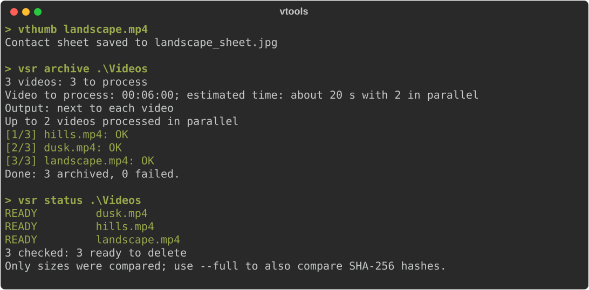

# videosemanticreducer

**Archive videos before deleting them, and prove later that a copy is the same video.**

Part of [video-tools](../../README.md). `vsr` is the same program with a shorter name, and
`vtools archive|fingerprint|compare|verify|status` runs it too. Installation: see the
[main README](../../README.md#installation).

<p align="center">
  
</p>

## Contents

- [What an archive holds](#what-an-archive-holds)
- [Quick start](#quick-start)
- [Commands](#commands)
- [Archiving a folder again](#archiving-a-folder-again)
- [How archives are checked](#how-archives-are-checked)
- [Default settings](#default-settings)
- [Where its files are](#where-its-files-are)
- [Fingerprint format](#fingerprint-format)
- [Earlier versions](#earlier-versions)

## What an archive holds

For `movie.mp4`, the folder `movie_summary\`, next to the video or inside `-o`:

| File | Content |
|---|---|
| `movie_summary.mp4` | An 8 s info card followed by 150 evenly spaced snapshots of the whole video |
| `movie_sheet.jpg` | Contact sheet: a 12x12 grid of frames covering the whole video |
| `movie_info.txt` | Container, stream and tag metadata |
| `movie.fingerprint.json` | SHA-256, global perceptual hashes and per-position hashes, for `verify` and `compare` |
| `movie.archive.json` | Manifest, written last: the source video, the options used and every file above with its size and SHA-256 |

The manifest says `"complete": true` only when every requested file was written and checked. A
failed run writes it with `"complete": false` and the error, and an interrupted run leaves none.
Files are written under a temporary `.part` name and renamed when finished, so a file with its
final name is never truncated.

## Quick start

```bash
vsr movie.mp4                                  # movie_summary\ (`archive` is the default command)
vsr archive D:/Videos -r -o D:/Archive         # every video in the folder and its subfolders
vsr archive D:/Videos --dry-run                # the plan and the estimated time, nothing written
vsr status D:/Videos -o D:/Archive --full      # before deleting: complete and unchanged?
vsr verify download.mp4 movie_summary/movie.fingerprint.json   # is this the archived video?
```

`vsr` without arguments shows the commands; `vsr help COMMAND` (or `COMMAND --help`, `/?`) shows
the options of one. Paths without a command run `archive`, unless `console.default_task` in the
[config file](#default-settings) says `fingerprint` or `status`.

## Commands

`archive`, `fingerprint` and `status` take any number of videos, folders and patterns (`*.mp4`),
and `--input-list FILE` with one path per line. See
[Choosing the videos](../../README.md#choosing-the-videos). `-v/--verbose` and `-q/--quiet` work
with every command, before or after its name.

### `archive`

| Option | Description | Default |
|---|---|---|
| `-n`, `--num-snapshots N` | Snapshots in the summary video | `150` |
| `-d`, `--snap-duration SECONDS` | Time each snapshot is shown | `0.4` |
| `--grid CxR` | Columns and rows of the contact sheet | `12x12` |
| `--no-summary`, `--no-sheet`, `--no-fingerprint` | Leave out that artifact | all on |
| `-o`, `--output PATH` | For one video: its archive folder. Otherwise a folder that receives `<name>_summary\` of each video, recreating subfolders with `-r` | next to each video |
| `-r`, `--recursive` | Include subfolders | off |
| `-w`, `--workers N` | Videos archived in parallel | automatic |
| `--skip-existing` / `--overwrite` | Skip videos whose archive is complete, or archive every video again | `--skip-existing` |
| `--dry-run` | Show the plan with one line per video and stop | off |
| `--strict` | Treat incomplete archives (DEGRADED, exit code 3) as failures (exit code 1) | off |
| `--open` | Open the output folder when done | off |
| `--no-progress` | One line per video instead of the live progress bar | off |
| `--json` | One JSON document with the plan and the results on stdout; see [Scripting](../../README.md#scripting-exit-codes-and-json) | off |
| `--config FILE` | Another [defaults file](#default-settings) | see below |

Before a folder is processed, `archive` prints its plan. The plan lists:

- the videos to archive, those already done and those done with other settings;
- the length of video to process;
- an estimate of the time, learned from earlier runs on this computer;
- the files that are only in OneDrive, since reading them downloads them.

In a terminal, a progress bar for the batch and a row per video with its current stage follow.

### `status`

Checks the archives before the originals are deleted. It takes videos, archive folders or folders
of videos (`-r` for subfolders; `-o` and `--config` as given to `archive`) and prints one line per
video:

| Status | Meaning |
|---|---|
| `READY` | The manifest says the archive is complete, every artifact is there with its size, and the original, if still present, is the video archived. The original can be deleted. |
| `INCOMPLETE` | Archived, but some artifacts are incomplete; run `archive` again |
| `FAILED` | The archive run failed or did not finish |
| `CHANGED` | An artifact is missing or was modified, or the original is not the video archived |
| `NOT ARCHIVED` | No archive was found where `archive` would put it |

Archives whose original was already deleted are listed too.

- `--full` also compares the SHA-256 of every artifact and of the original with the manifest. It
  reads every file; use it before deleting.
- `-q` only lists the archives that are not ready.
- With `--json`, the output has one entry per archive, whose `status` is `ready`, `incomplete`,
  `failed`, `changed` or `not_archived`.

The exit code is 0 only when every archive is `READY`.

### `fingerprint`

Only the fingerprint, for videos that do not need a full archive:
`<name>.fingerprint.json` next to each video, or `-o FILE` for a single one.

### `verify` and `compare`

```bash
vsr verify copy.mp4 movie.fingerprint.json        # a video against a saved fingerprint
vsr compare a.fingerprint.json b.fingerprint.json # two fingerprints
```

Both print a match level and its confidence:

| Level | Means |
|---|---|
| `EXACT` | Same file: the SHA-256 is the same |
| `VERY_HIGH` | The same video, re-encoded or re-downloaded: the perceptual hashes match |
| `HIGH` | Probably the same video, but not certain enough to delete on its word |
| `MEDIUM`, `LOW` | Partly similar, such as an edited or cut version |
| `NONE` | Different videos, or durations that do not match |

They exit with 0 for `EXACT` and `VERY_HIGH`, with 1 otherwise (different or uncertain) and with
2 when a file cannot be read.

## Archiving a folder again

Videos whose archive is already complete are skipped. An interrupted or partly failed run over a
folder can simply be started again. A video is archived again when:

- its manifest is missing or incomplete;
- one of its files changed or disappeared;
- an artifact is asked for that was not made the first time, such as the fingerprint after a
  `--no-fingerprint` run.

Archives made with other settings, such as another grid size, are reported and kept;
`--overwrite` redoes every video.

Folder scans skip hidden files and folders (such as macOS `._movie.mp4` files). Recursive scans
skip the `<name>_summary` folders of earlier runs, so summary videos are never archived again.
Two videos with the same name in the same place, such as `clip.mp4` and `clip.mkv`, get
`clip.mp4_summary\` and `clip.mkv_summary\`.

## How archives are checked

A video only counts as archived when its fingerprint is complete, since the fingerprint is what
later proves that a copy is the same video. The run fails, and writes no fingerprint, when:

- the file has no video stream;
- no frame could be hashed for the global hashes;
- fewer than half of the per-position frames could be hashed.

Every artifact is read back before the manifest is written:

- the summary video must open and last as long as expected;
- the contact sheet must have the expected size;
- the fingerprint must load.

An unreadable artifact fails the video. A summary or sheet with fewer than 90% of its frames
decoded makes the archive DEGRADED. The archive is kept and its manifest lists the `problems`,
but it is not marked complete, so the next run archives the video again. The command then exits
with 3, or with 1 with `--strict`.

## Default settings

The defaults of `archive` can be kept in a YAML file instead of passing the same flags every
time. Flags on the command line still take precedence.

```bash
vsr config set num_snapshots 100   # change one default
vsr config unset num_snapshots     # back to the built-in default
vsr config show                    # the defaults in effect and where they come from
vsr config edit                    # open the file in an editor (created first if needed)
vsr config init                    # write a commented file with every option
vsr config path                    # where it is
```

```yaml
archive:
  num_snapshots: 100
  sheet_columns: 10    # --grid 10x8 on the command line
  sheet_rows: 8
  output: D:/Archive   # relative paths are relative to the config file
console:
  notify_after: 10     # minutes a run must take to end with a notification; 0 = never
```

The `console` section also has `keep_awake`, `pause` and `default_task` (see the
[main README](../../README.md#in-the-terminal-and-in-the-explorer)). Option names are unique
across sections, so `config set notify_after 10` works too.

`config set` checks the value and changes only that line, keeping your comments. A relative path
given to `config set output` is taken from the current folder. The editor is `$VISUAL` or
`$EDITOR` when set, otherwise the system's editor for text files. Unknown options, values of the
wrong type and values out of range (such as `num_snapshots: 0`) are reported with the file name,
and nothing is processed.

## Where its files are

| What | Windows | Elsewhere |
|---|---|---|
| Config file | `%APPDATA%\videosemanticreducer\config.yaml` | `$XDG_CONFIG_HOME/videosemanticreducer/config.yaml` |
| Logs, lists of videos to retry, `state.json` (speed on this computer) | `%LOCALAPPDATA%\videosemanticreducer` | `$XDG_STATE_HOME/videosemanticreducer` |

`--config FILE` or the `VIDEOSEMANTICREDUCER_CONFIG` environment variable select another config
file. Everything under the second folder can be deleted at any time.

## Fingerprint format

Version `2.0` takes every hashed frame with precise seeking, so the hashes depend on the content
and not on where the encoder placed keyframes. Fingerprints in format `1.0` can still be compared.
Their global hashes were taken from keyframes only, so that layer is skipped, and the match level
is decided by the file hash and the per-position hashes.

## Earlier versions

The names of versions before 0.2 still work, with a warning that shows the new one; they will be
removed:

- `process`, now `archive`;
- `--video/--no-video`, now `--summary/--no-summary`;
- `--thumbnail/--no-thumbnail`, now `--sheet/--no-sheet`;
- `--thumb-cols N`/`--thumb-rows N`, now `--grid CxR`.

Archives made before 0.2 have `movie_thumb.jpg` instead of `movie_sheet.jpg`. `status` still
checks them, and archiving one again replaces it.
