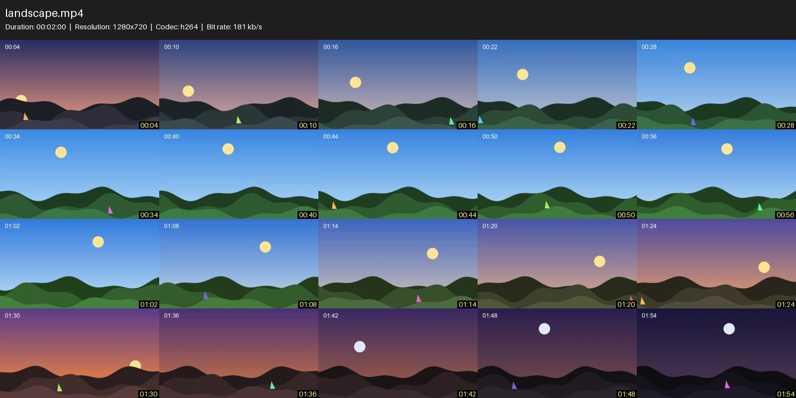

# videothumb

**Previews of your videos: contact sheets, full-size frames, or both in one ZIP.**

Part of [video-tools](../../README.md). `vthumb` is the same program with a shorter name, and
`vtools sheet|frames|pack|gui` runs it too. Installation: see the
[main README](../../README.md#installation).

<p align="center">
  
</p>

## Contents

- [What it makes](#what-it-makes)
- [Quick start](#quick-start)
- [Commands](#commands)
- [Options of every command](#options-of-every-command)
- [How frames are chosen](#how-frames-are-chosen)
- [Folders and batches](#folders-and-batches)
- [Desktop app](#desktop-app)
- [Default settings](#default-settings)
- [Where its files are](#where-its-files-are)
- [Earlier versions](#earlier-versions)

## What it makes

For `movie.mp4`, next to the video unless `-o` says otherwise:

| Command | Output | Content |
|---|---|---|
| `sheet` | `movie_sheet.jpg` | The video's details (name, duration, resolution, codec, bit rate) above a grid of frames, each labeled with its time |
| `frames` | `movie_frames\` | Full-size frames, named after the video and the moment they show: `movie_f001_00h12m34s.jpg` |
| `pack` | `movie_pack.zip` | `movie_sheet.jpg` and a `frames\` folder, in one file that Windows opens like a folder |

## Quick start

```bash
vthumb movie.mp4                            # movie_sheet.jpg (`sheet` is the default command)
vthumb sheet movie.mp4 --columns 6 --rows 5 # a bigger grid
vthumb frames movie.mp4 --count 15          # 15 frames in movie_frames\
vthumb pack ./videos -r                     # one ZIP per video, subfolders included
vthumb sheet ./videos ./more/*.mkv --input-list extra.txt -o ./sheets
vthumb sheet ./videos --dry-run             # what would be done, and how long it would take
vthumb gui                                  # the desktop app
```

`vthumb` without arguments shows the commands; `vthumb help COMMAND` (or `COMMAND --help`, `/?`)
shows the options of one. Paths without a command run `sheet`, or the command set as
`console.default_task` in the [config file](#default-settings).

## Commands

### `sheet`

A contact sheet per video.

| Option | Description | Default |
|---|---|---|
| `--columns N`, `--rows N` | Grid of thumbnails | `5`, `4` |
| `--thumbnail-width N` | Width of each thumbnail in pixels | `320` |
| `--quality N` | JPEG quality (1-100) | `90` |

### `frames`

A folder of full-size frames per video, evenly spaced over the whole video.

| Option | Description | Default |
|---|---|---|
| `--count N` | Frames to save | `10` |
| `--quality N` | JPEG quality (1-100) | `90` |

Frame names carry the video and the time, so frames can be moved or mixed with others: frames
of several videos never overwrite each other in one folder.

### `pack`

The contact sheet and its frames in one ZIP. It takes the options of `sheet` and `--count`.

By default each frame is the full-size version of one cell of the sheet, so the video is decoded
once. A `--count` other than columns x rows decodes it a second time for the sheet. The JPEGs are
stored without compressing them again.

### `gui`

Opens the [desktop app](#desktop-app).

## Options of every command

`sheet`, `frames` and `pack` take any number of videos, folders and patterns (`*.mp4`), and
`--input-list FILE` with one path per line. See
[Choosing the videos](../../README.md#choosing-the-videos).

| Option | Description | Default |
|---|---|---|
| `-o`, `--output PATH` | For one video: the sheet file, frames folder or ZIP. Otherwise a folder for every output, recreating subfolders with `-r` | next to each video |
| `-r`, `--recursive` | Include subfolders (`--no-recursive` undoes the config file) | off |
| `-w`, `--workers N` | Videos processed in parallel | automatic |
| `--precise` | Every frame at its exact position (slower); see [below](#how-frames-are-chosen) | off |
| `--overwrite` / `--skip-existing` | Replace existing outputs, or leave videos whose output already exists | `--overwrite` |
| `--dry-run` | Show the plan for each video and stop, without writing anything | off |
| `--strict` | Treat incomplete outputs (DEGRADED, exit code 3) as failures (exit code 1) | off |
| `-q`, `--quiet` | Only warnings, errors and what to do about them | off |
| `-v`, `--verbose` | Also debug messages (they always go to the log file) | off |
| `--open` | Open the output folder when done | off |
| `--no-progress` | One line per video instead of the live progress bar | off |
| `--json` | One JSON document with the plan and the results on stdout; see [Scripting](../../README.md#scripting-exit-codes-and-json) | off |
| `--config FILE` | Another [defaults file](#default-settings) | see below |

## How frames are chosen

By default each frame comes from the nearest keyframe at or before its position, which is
several times faster than decoding up to the exact time. Thumbnails and frame names show the
time of the frame actually taken.

When two positions would fall on the same keyframe (videos with keyframes far apart, such as
screen recordings) or a keyframe cannot be decoded, that position is taken at its exact time
instead, so a sheet never shows the same frame twice. `--precise` takes every position at its
exact time.

## Folders and batches

With several videos, a plan comes first: videos to process and already done, the length of video
to process and an estimate of the time, learned from earlier runs on this computer. In a
terminal, a progress bar for the batch and a row per video follow. Each finished video leaves one
line, and a summary ends the run. See [In the terminal and in the Explorer](../../README.md#in-the-terminal-and-in-the-explorer).

- Each sheet and frame is read back after being written. When fewer than 90% of a video's frames
  could be decoded, the video is reported as DEGRADED (incomplete) and the command exits with 3.
- A video whose data ends before its header says (a cut or unfinished recording) gives a sheet
  with the missing positions reported, not the last frame repeated.
- Folder scans skip hidden files and folders.
- When two videos would write under the same name, such as `clip.mp4` and `clip.mkv`, their
  outputs include the extension (`clip.mp4_sheet.jpg`, `clip.mkv_frames\`).

## Desktop app

`vthumb gui` opens a small window. Choose a video or a folder, then the contact sheet or the
frames and their settings, and press Generate. The app shows the progress, can be cancelled, and
opens the output folder at the end. It remembers its own settings and does not read the config
file of the command line.

## Default settings

The defaults of the command line can be kept in a YAML file, with one section per command
(`sheet`, `frames`, `pack`), a `run` section for folders, and a `console` section for
notifications, sleep and the pause when started from the Explorer (see the
[main README](../../README.md#in-the-terminal-and-in-the-explorer)). Flags on the command line
still take precedence.

```bash
vthumb config set sheet.columns 6     # change one default
vthumb config set run.workers 2
vthumb config unset sheet.columns     # back to the built-in default
vthumb config show                    # the defaults in effect and where they come from
vthumb config edit                    # open the file in an editor (created first if needed)
vthumb config init                    # write a commented file with every option
vthumb config path                    # where it is
```

```yaml
sheet:
  columns: 6
  jpeg_quality: 95
  sampling: precise    # like --precise
frames:
  count: 15
run:
  recursive: true      # --no-recursive turns it off for one run
  workers: 2
```

`config set` checks the value and changes only that line, keeping your comments. Invalid values
are reported with the file name, and nothing is processed.

## Where its files are

| What | Windows | Elsewhere |
|---|---|---|
| Config file | `%APPDATA%\videothumb\config.yaml` | `$XDG_CONFIG_HOME/videothumb/config.yaml` |
| Logs, lists of videos to retry, desktop app settings, `state.json` (speed on this computer) | `%LOCALAPPDATA%\videothumb` | `$XDG_STATE_HOME/videothumb` |

`--config FILE` or the `VIDEOTHUMB_CONFIG` environment variable select another config file.
Everything under the second folder can be deleted at any time.

## Earlier versions

The forms of versions before 0.2 (`--video`/`--folder` with `--mode sheet|snapshots`, and the
`snapshots` command) still work, with a warning that shows the new command; they will be removed.
